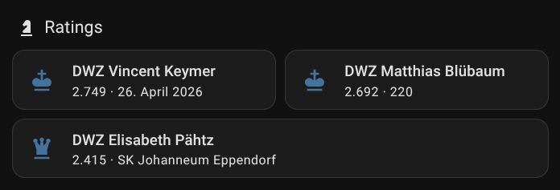

# DWZ (German Chess Federation) Rating — Home Assistant integration ♟️

This integration exposes DWZ data (Deutscher Schachbund) as Home Assistant sensors.

## Quick overview

- One sensor per configuration entry (per player / `nuLiga` ID).
- Sensor state: the player's current DWZ rating (`rating`).
- Additional information is exposed as entity attributes (see Attributes).

## Attributes

- `rating` — current DWZ rating (also entity state)
- `rating_week` — evaluation week (e.g. "202617")
- `rating_date` — ISO date (YYYY‑MM‑DD) of the Sunday's end of the evaluation week
- `index` — sequential index of the DWZ evaluation
- `active_club` — club holding the player's active licence
- `firstname`, `lastname`, `full_name` — player's names
- `gender` — `MALE` / `FEMALE`
- `birth_year`, `fide_id`, `nuliga_id`

## Installation

### Via HACS (recommended) 🧩

1. Open HACS → Integrations.
2. Click the three dots → "Custom repositories".
3. Add repository `f-zappa/ha-dwz` (Category: Integration).
4. Search HACS for "DWZ (Schachbund)" and install.
5. Restart Home Assistant and add the integration via Settings → Integrations.

### Manual (developer / local) 🧰

1. Copy the `custom_components/dwz` directory into your Home Assistant `custom_components` folder.
2. Restart Home Assistant or reload integrations.

## Configuration

- Find the player on the DSB search page https://www.schachbund.de/dwz-spieler.html.
  The search results show links which contain the nuLiga-ID.
- In HA: Settings → Add integration → `DWZ (Schachbund)`.
- Enter the player's nuLiga-ID (e.g. `NU4168433`).

## More details

- 📦 This integration uses the `dwzclient` Python package (PyPI: https://pypi.org/project/dwzclient/)  `dwzclient` fetches data from the Deutsche Schachbund's public API (new API published July 2026).
- 🤖+👨🏼‍💻 This integration as well as `dwzclient` were developed with assistance from an AI coding assistant. All code, documentation and repository structure were created with AI support and have since been reviewed and manually refined — the result is not purely auto‑generated but contains hand‑crafted improvements and human review. ✍️

- 🙏 Thanks to @ludeeus for the very helpful integration blueprint (https://github.com/ludeeus/integration_blueprint)!
